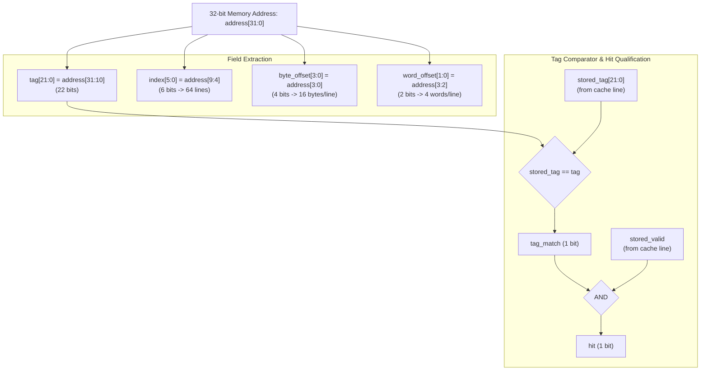

# Address Decoder Datapath & Field Extraction

### Signal Summary
- **Inputs**:
  - `address[31:0]`: CPU / memory request address (32-bit aligned, `[1:0] == 2'b00`).
  - `stored_tag[21:0]`: 22-bit tag stored in cache storage at `lookup_index`.
  - `stored_valid`: Valid flag of the cache line at `lookup_index`.
- **Outputs**:
  - `tag[21:0]`: Tag field passed to controller.
  - `index[5:0]`: Cache line index forwarded to cache storage `lookup_index`.
  - `byte_offset[3:0]`: Byte offset within line.
  - `word_offset[1:0]`: Word offset forwarded to cache storage `lookup_word_offset`.
  - `tag_match`: Equality indicator between `stored_tag` and `tag`.
  - `hit`: High only when both `stored_valid` and `tag_match` are asserted.

